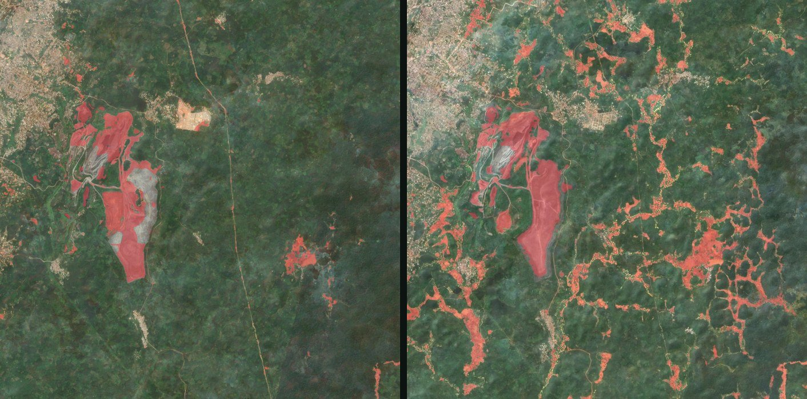
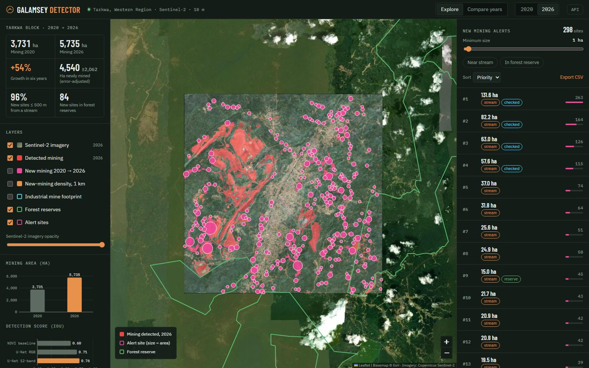
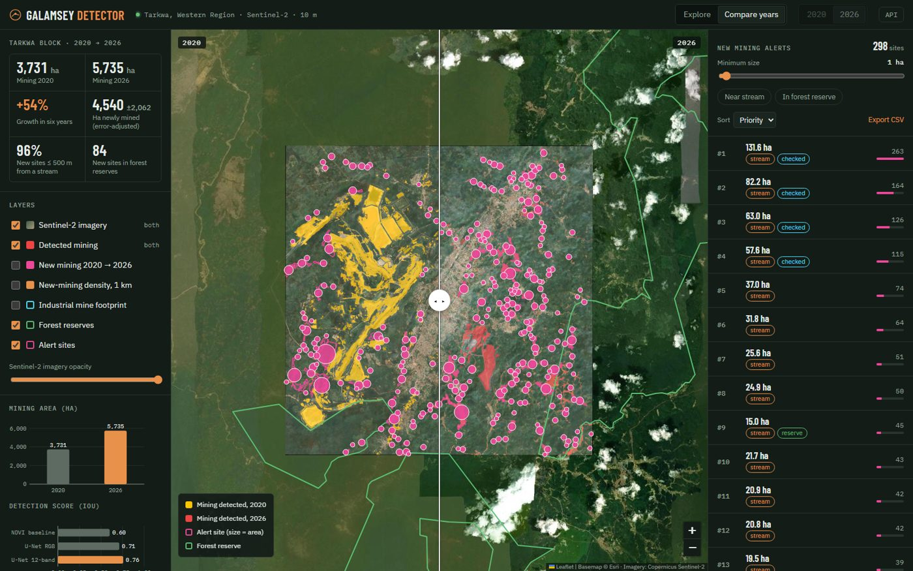
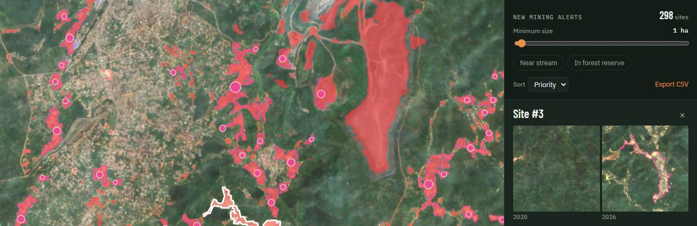
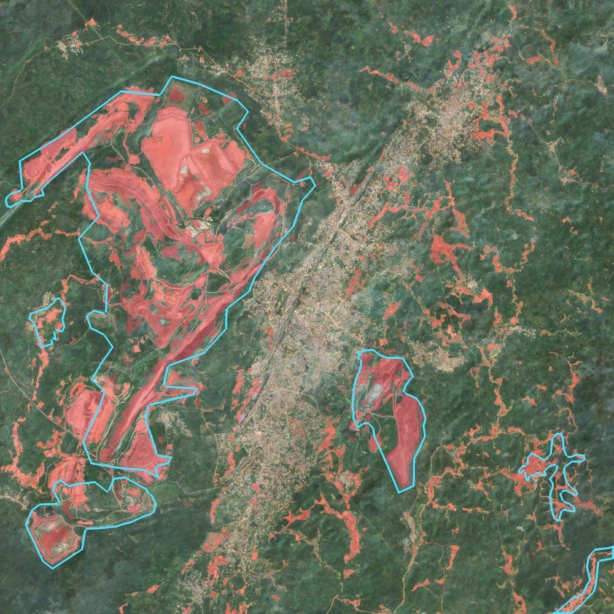

# Galamsey Detector

[](https://github.com/umclarence1/Gala-Detect/actions/workflows/ci.yml)


Map small-scale gold mining (*galamsey*) in Ghana from free Sentinel-2 imagery with a U-Net, measure how much land was newly disturbed between two dates, and rank new sites by how close they are to streams and forest reserves. Results are served in a local monitoring app.



## Results (Tarkwa, Western Region, 420 km²)

| | 2020 dry season | 2026 dry season |
|---|---|---|
| Mining detected | 3,731 ha (8.9%) | 5,735 ha (13.7%) |

- **+54%** mining area in six years.
- **4,540 ± 2,060 ha newly disturbed** (error-adjusted with a stratified 180-point sample, Olofsson et al. 2014; pixel count 3,045 ha).
- **96%** of 1,105 new sites outside the industrial-mine footprint lie within 500 m of a stream; **84** lie inside forest reserves.
- 12 Sentinel-2 bands beat RGB: IoU **0.76** vs **0.71** (NDVI baseline 0.60) on held-out Tarkwa tiles.

Scores are measured against rule-based labels, and the validation points were interpreted visually (by an AI assistant, blind to the model output) without field checks. See [Limitations](#limitations).

## The app

```bash
python -m webapp.server   # http://localhost:8050, API docs at /api/docs
```

| Explore | Compare years |
|---|---|
|  |  |



- Layers: Sentinel-2 imagery per year, detected mining, new mining, 1 km density, industrial footprint, forest reserves, alert sites
- Swipe compare between 2020 and 2026
- Alert queue with filters (size, near stream, in forest reserve), sorting, CSV export
- Click a site to fly to it and see 2020/2026 crops generated by the API
- Deep links: `#compare`, `#y2020`, `#grid`, `#new`, `#footprint`, `#site-3`

## How it works

```
Sentinel-2 (Earth Engine) ─► dry-season composites ─┐
Maus et al. polygons + stream-side bare-soil rule ──┴► labels ─► U-Net ─► 2020 / 2026 maps ─► change, area, alerts ─► app
```

1. **Composites.** Every Sentinel-2 L2A pass from November to February, cloud-masked with Cloud Score+ and reduced to a 12-band median.
2. **Labels.** The Maus et al. (2022) global mining polygons cover industrial pits but miss most galamsey, so labels combine them (trimmed to bare ground and water) with a rule: bare soil or muddy water within 300 m of a stream (MERIT Hydro), minus built-up areas (ESA WorldCover). Hand-drawn polygons override the rule.

   

3. **Tiles and splits.** 256 × 256 px tiles (2.56 km) on a UTM grid across the Ankobra, Pra and Offin basins. Train and validation use separate 10 km blocks; the Tarkwa block is held out with a 2 km buffer.
4. **Model.** U-Net with an ImageNet ResNet-18 encoder (`segmentation-models-pytorch`), Dice + BCE loss, trained on CPU.
5. **Change and area.** New mining = mining in the later year and not the earlier one. Area is error-adjusted from a stratified random sample.
6. **Alerts.** New patches outside the licensed footprint, ranked by area, doubled near streams and ×1.5 inside protected areas (WDPA).

## Quick start

```bash
python -m venv .venv
.venv\Scripts\activate            # Windows (source .venv/bin/activate elsewhere)
pip install -r requirements.txt
earthengine authenticate
```

1. Register a Google Cloud project for [Earth Engine](https://code.earthengine.google.com/register) (noncommercial) and set `project.gee_project` in [config.yaml](config.yaml).
2. Download the [Maus et al. v2 polygons](https://doi.pangaea.de/10.1594/PANGAEA.942325) to `data/raw/maus/global_mining_polygons_v2.gpkg`.
3. Run everything:

```bash
python -m gee.check_setup          # confirm Earth Engine works
python run_pipeline.py             # tiles -> train -> evaluate -> predict -> change -> alerts -> map
python -m webapp.build_assets      # prepare app layers
python -m webapp.server
```

The tile export downloads about 1.2 GB. Training both models takes about 45 minutes on a laptop CPU.

## Commands

| Command | What it does |
|---|---|
| `python run_pipeline.py [--from STEP] [--relabel]` | Whole pipeline, resumable; `--relabel` refreshes tiles touched by hand labels |
| `python -m gee.composite` | Interactive preview of the composites |
| `python -m gee.labels` | PNG snapshots of the labels |
| `python -m gee.export_tiles` | Select and download tiles, make spatial splits |
| `python -m model.train --experiment rgb\|all_bands` | Train a U-Net |
| `python -m model.evaluate` | Score baseline and models → `report/results.md` |
| `python -m model.predict` | Prediction GeoTIFFs → `outputs/predictions/` |
| `python -m analysis.change` | Hectares of change; sample points for error-adjusted area |
| `python -m analysis.alerts` | Ranked new-mining sites |
| `python -m analysis.turbidity` | River turbidity per period |
| `python -m webapp.build_assets` / `webapp.server` | Build and serve the app |
| `python -m webapp.screenshot` / `app.build_post` | Screenshots and a LinkedIn carousel |
| `pytest` / `ruff check .` | Tests and lint |

All settings (regions, dates, thresholds, model) live in [config.yaml](config.yaml).

## Project structure

```
common/      config loading
gee/         Earth Engine: composites, labels, tile export, label squares
model/       dataset, U-Net training, evaluation, prediction
analysis/    change and error-adjusted area, alerts, turbidity
app/         static map, dashboard and post builders
webapp/      FastAPI server and Leaflet front end
tests/       unit tests
docs/        labelling guide, images
report/      write-up and result files
```

## Limitations

- **Mining, not legality.** The Maus footprint stands in for licence boundaries; some top alerts are new works at industrial mines. Minerals Commission concession data would fix this (`labels.concessions_file` in the config).
- **Provisional labels.** The model learns from a spectral rule, so IoU/F1 measure agreement with that rule.
- **Validation.** The 180 reference points were interpreted from 10 m imagery by an AI assistant, blind to the model output, without field or expert checks; 23 were too uncertain to call. The area interval is wide.
- **Two dates.** The comparison shows net change, not when sites started. Monthly runs would be needed for early warning.
- **Responsible use.** The repository does not publish site coordinates. Share precise alerts only with partners who can verify them safely.

## Data and references

- Copernicus Sentinel-2 L2A (ESA), via Google Earth Engine
- Cloud Score+: Pasquarella et al. (2023)
- Maus, V. et al. (2022). An update on global mining land use. *Scientific Data* 9, 433.
- MERIT Hydro: Yamazaki et al. (2019); ESA WorldCover 2021; WDPA
- Olofsson, P. et al. (2014). Good practices for estimating area and assessing accuracy of land change. *Remote Sensing of Environment* 148.
- Ronneberger, O. et al. (2015). U-Net. *MICCAI*.

## License

[MIT](LICENSE)
